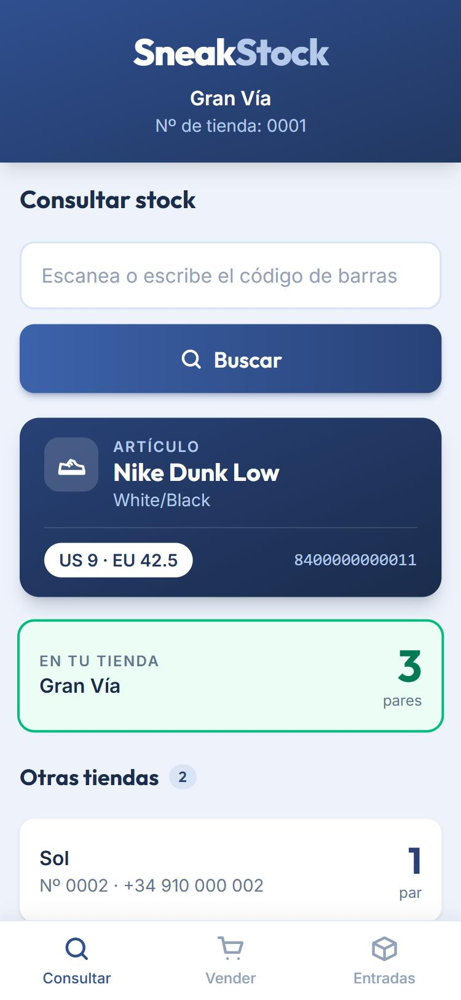
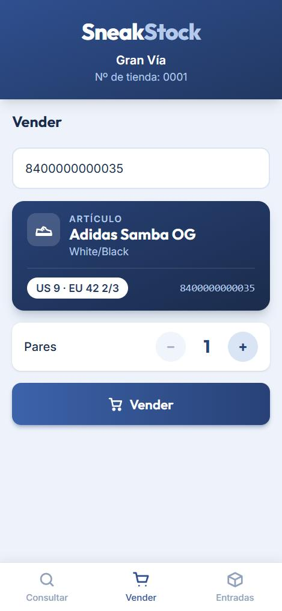
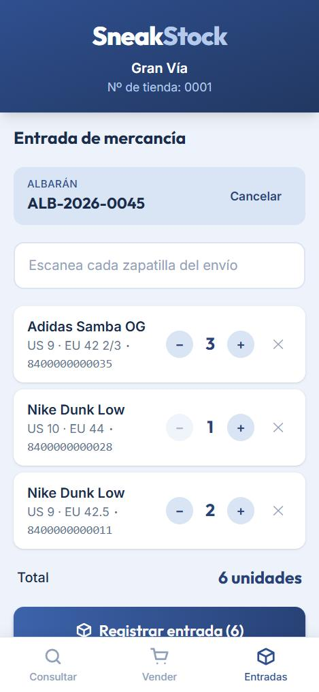
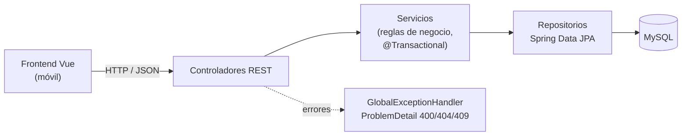

# SneakStock

[](https://github.com/eduardobj1905/sneakstock/actions/workflows/ci.yml)

**Gestión de stock para una cadena de tiendas de zapatillas, pensada para usarse desde el móvil como una PDA de tienda.**

El dependiente escanea una caja y ve al instante qué zapatilla es, cuántos pares quedan en su tienda y, si el cliente lo pide, en qué otras tiendas hay. Desde la misma app registra ventas, recibe albaranes de mercancía y hace traspasos entre tiendas, sin que el stock pueda quedar en negativo ni descuadrarse.

> Proyecto personal en desarrollo. Lo diseño a partir de 8 años de experiencia trabajando en tiendas de zapatillas, los 2 últimos como Shift Leader: cada regla de negocio sale de un problema real de stock en tienda.

<p align="center">
  
  &nbsp;
  
  &nbsp;
  
</p>

## Funcionalidades

| Pantalla | Qué hace |
|---|---|
| **Consultar** | Escaneas una caja y ves la zapatilla y los pares que hay en tu tienda. Las demás tiendas se consultan solo bajo demanda, con un botón. |
| **Vender** | Escaneas, compruebas que es la zapatilla correcta antes de confirmar y registras la venta. Si no hay pares suficientes, la app te lo dice con el stock exacto. |
| **Entradas** | Escaneas el número de albarán y cada zapatilla del envío; la app agrupa las unidades por talla. Cuando la lista cuadra con el albarán, lo registras todo de una vez. |
| **Traspasos** | Envías pares a otra tienda y la app te da el número de traspaso para apuntarlo en la caja. Mientras viajan no cuentan en ninguna tienda. La tienda destino escanea ese número, ve qué llega y lo recibe; si faltan pares, queda anotado. |

## Stack

| Capa | Tecnologías |
|---|---|
| **Backend** | Java 21, Spring Boot 4, Spring Data JPA (Hibernate), Bean Validation |
| **Base de datos** | MySQL 8.4 en Docker, migraciones con Flyway |
| **Frontend** | Vue 3 + TypeScript, Vue Router, Tailwind CSS 4, Vite |
| **Tests** | JUnit 5, Mockito, MockMvc (`@WebMvcTest`), Testcontainers, Vitest + Vue Test Utils |
| **Calidad y despliegue** | GitHub Actions, Swagger / OpenAPI (springdoc), Docker (imagen única con frontend y API) |

## Arquitectura

Monorepo: el backend (Spring Boot) y el frontend (`frontend/`) viven en el mismo repositorio, así que cada funcionalidad completa entra en un solo pull request.



El backend está organizado **por funcionalidad** (`catalog`, `store`, `stock`, `common`) en lugar de por capa, y cada paquete agrupa su entidad, repositorio, servicio y controlador.

- [Modelo de datos y diagrama entidad-relación](docs/modelo-datos.md)
- [Decisiones de diseño](docs/decisiones/) (contexto, decisión y alternativas descartadas)

## Decisiones técnicas destacadas

- **El stock no se descuadra.** Cada operación (venta, entrada, traspaso) actualiza el stock y apunta el movimiento en la **misma transacción**: o se guardan las dos cosas o ninguna. Un albarán completo también se registra en una sola transacción.
- **Reglas en dos capas.** El stock nunca baja de cero: lo impide el dominio (`Stock.remove`) con un mensaje claro y, como red de seguridad, un `CHECK` en la base de datos.
- **Historial auditable.** El stock actual se guarda en una tabla y cada cambio queda registrado en `stock_movement` con su signo, así que cualquier cantidad se puede explicar.
- **Traspasos con estado "en tránsito"** sin tabla extra: un envío (`TRANSFER_OUT`) y su recepción (`TRANSFER_IN`) enlazados. No se puede recibir dos veces ni en otra tienda.
- **Errores con su código HTTP correcto** en formato estándar `ProblemDetail` (RFC 9457): 404 si algo no existe, 409 si se incumple una regla de negocio, 400 si la petición no es válida, con el mensaje de cada campo.
- **Prevenir antes que corregir.** Antes de confirmar una venta o una entrada, la app enseña qué zapatilla corresponde al código escaneado, para detectar etiquetas o escaneos equivocados.
- **Migraciones versionadas** con Flyway: el esquema solo cambia con migraciones nuevas; las aplicadas no se editan.
- **Tests de integración aislados** con Testcontainers: cada ejecución arranca su propio MySQL de usar y tirar, igual en local que en GitHub Actions.
- **Una sola imagen Docker** para desplegar: el frontend compilado se sirve desde Spring Boot, sin proxy ni CORS en producción.

## Cómo arrancarlo

**Requisitos:** Java 21, Node.js 22 y Docker Desktop.

**1. Base de datos:**

```bash
docker compose up -d --wait
```

**2. Backend** (crea las tablas con Flyway al arrancar; queda en `http://localhost:8080`). En PowerShell, `.\mvnw` en lugar de `./mvnw`:

```bash
./mvnw spring-boot:run
```

**3. Datos de ejemplo**, con el backend ya arrancado una vez: 4 tiendas (una cerrada), 2 modelos y su stock.

```bash
docker compose cp docs/datos-ejemplo.sql mysql:/tmp/datos-ejemplo.sql
docker compose exec mysql sh -c "mysql --default-character-set=utf8mb4 -usneakstock -psneakstock sneakstock < /tmp/datos-ejemplo.sql"
```

**4. Frontend** (en `http://localhost:5173`, con un proxy hacia el backend):

```bash
cd frontend
npm install
npm run dev
```

La documentación interactiva de la API está en `http://localhost:8080/swagger-ui.html`.

**Todo con Docker**, sin instalar Java ni Node: `docker compose --profile app up --build` y la app queda en `http://localhost:8081`.

La app trabaja como la tienda **0001 · Gran Vía**. Códigos de barras para probar:

| Código | Zapatilla |
|---|---|
| `8400000000011` | Nike Dunk Low · US 9 / EU 42.5 |
| `8400000000028` | Nike Dunk Low · US 10 / EU 44 |
| `8400000000035` | Adidas Samba OG · US 9 / EU 42 2/3 |

## Tests

```bash
./mvnw test                 # backend: 30 tests (requiere Docker para Testcontainers)
cd frontend && npm run test:unit -- --run   # frontend: 21 tests
```

- **Unitarios** de las reglas de negocio con Mockito, sin base de datos.
- **Capa web** con `@WebMvcTest`: cada error llega con su código HTTP y su mensaje.
- **Integración** contra un MySQL real arrancado con Testcontainers.
- **GitHub Actions** ejecuta en cada pull request los tests, los linters, la comprobación de tipos y el build.
- **Frontend** con Vitest, simulando el backend.

## API

Documentación completa e interactiva en `/swagger-ui.html`.

| Método | Ruta | Descripción |
|---|---|---|
| `GET` | `/api/stores` | Tiendas abiertas de la cadena |
| `GET` | `/api/variants/{barcode}` | Qué zapatilla y qué talla es un código de barras |
| `GET` | `/api/stock/stores/{storeNumber}?barcode=` | Pares de una talla en una tienda |
| `GET` | `/api/stock?barcode=` | Tiendas abiertas con pares de una talla |
| `POST` | `/api/stock/sales` | Registrar una venta |
| `POST` | `/api/stock/entries` | Registrar una entrada de una talla |
| `POST` | `/api/stock/deliveries` | Registrar un albarán completo |
| `POST` | `/api/stock/transfers` | Enviar un traspaso a otra tienda (devuelve su número) |
| `GET` | `/api/stock/transfers/{id}` | Ver un traspaso antes de recibirlo |
| `POST` | `/api/stock/transfers/{id}/receptions` | Recibir un traspaso |

## Próximos pasos

- [ ] Despliegue con enlace público (preparado: [guía de despliegue](docs/despliegue.md))
- [ ] Login y roles (dependiente, encargado, central) con Spring Security y JWT

## Autor

**Eduardo Bernal** · Técnico Superior en DAM · [GitHub](https://github.com/eduardobj1905)
