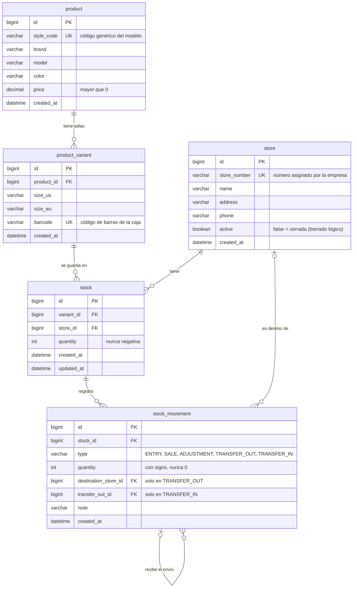

# Modelo de datos

Esquema de la base de datos, creado con las migraciones de Flyway V1–V5 (`src/main/resources/db/migration`). Las decisiones detrás de cada tabla están en [0002 — Modelo de stock](decisiones/0002-modelo-de-stock.md).

## Cómo se lee

- `||--o{` significa "uno a muchos". Por ejemplo, un modelo tiene cero o muchas tallas, y cada talla pertenece a un solo modelo.
- `|o--o{` significa que la relación es opcional. Por ejemplo, un movimiento solo tiene tienda destino si es un `TRANSFER_OUT`.
- `PK` es la clave primaria, `FK` una clave foránea y `UK` un valor único.

## Reglas que el diagrama no muestra

| Tabla | Regla | Para qué |
|---|---|---|
| `product_variant` | `UNIQUE (product_id, size_us)` | Un modelo no puede tener la misma talla dos veces. |
| `stock` | `UNIQUE (variant_id, store_id)` | Una sola fila de stock por talla y tienda. |
| `stock` | `CHECK (quantity >= 0)` | La base de datos rechaza un stock negativo. |
| `stock_movement` | `CHECK (type IN (...))` | Solo se admiten los cinco tipos de movimiento. |
| `stock_movement` | `CHECK (quantity <> 0)` | No se guardan movimientos que no mueven nada. |
| `product` | `CHECK (price > 0)` | El precio tiene que ser positivo. |
